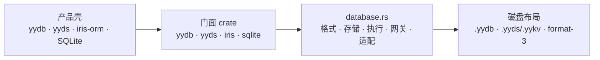
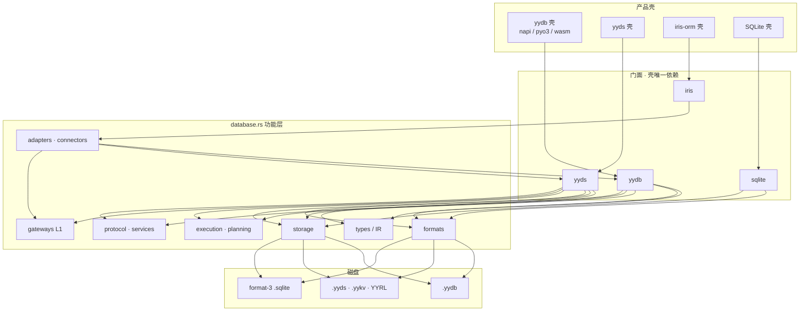
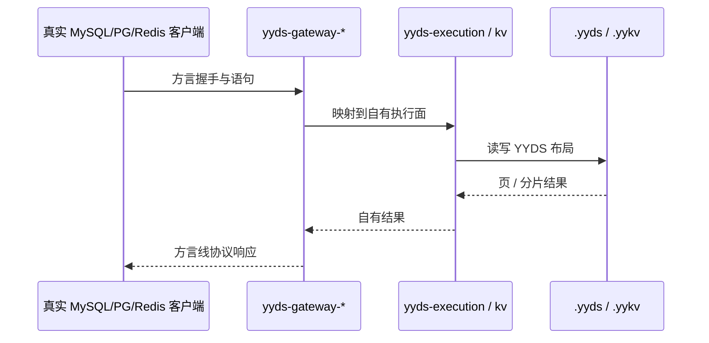
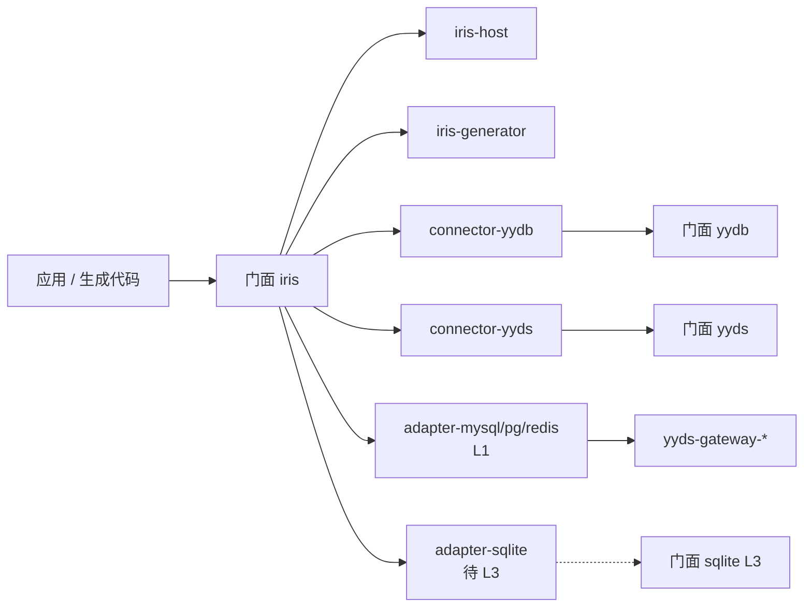
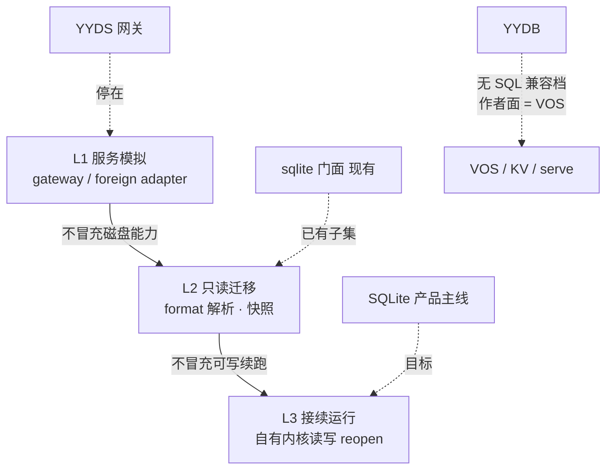

# database.rs

**YY 数据库家族的共享 Rust 内核** · 嵌入式单文件 · 分布式存储 · 方言伪装 · ORM 适配

[这是什么](#-这是什么) · [快速开始](#-快速开始) · [架构](#-架构) · [兼容三档](#-兼容三档) · [能力要点](#-能力要点) · [对比](#-和常见方案差在哪) · [示例](#-示例入口)

产品壳（`yydb` / `yyds` / `iris-orm` / `SQLite`）只做语言绑定、打包与品牌。格式、执行、网关与适配器在本仓演进，避免三份 fork。



## 💡 这是什么？

`database.rs` 是 **YYDB / YYDS / Iris / SQLite** 共用的实现仓。壳工程**只依赖对应门面**；内部角色 crate 不对外钉 `rev`。

| 产品门面 | 一句话 |
|----------|--------|
| `yydb` | 单文件嵌入式库，[VOS](https://github.com/voml/vos-language) 为唯一作者面 |
| `yyds` | 分布式存储 + 方言线协议伪装（**L1** 服务模拟） |
| `iris` | schema-first ORM 适配层 |
| `sqlite` | SQLite format-3 只读/快照（**L2**）；接续运行（**L3**）规划中 |

**不是**：第三方 MySQL / PostgreSQL / Redis / 官方 SQLite 引擎的包装层。网关与适配器走自有 wire；磁盘只落 YY / format-3 自有布局。

实现约定（`unsafe`、文档 lint、中文注释、一门面一依赖）见 [`AGENTS.md`](./AGENTS.md)。

## 🚀 快速开始

### 1. Agent（推荐）

在产品壳或本仓打开对话，说明要依赖的门面（`yydb` / `yyds` / `iris` / `sqlite`），并要求：

- 只钉门面 git 依赖（完整 40 位 `rev`）
- 本地 path 覆盖只 patch 门面，写在 gitignore 的 `.cargo/config.toml`
- 遵守本仓 [`AGENTS.md`](./AGENTS.md)

### 2. 手动接入

产品壳 `Cargo.toml`（以 YYDB 为例）：

```toml
[dependencies]
yydb = { git = "https://github.com/yy-database/database.rs.git", rev = "<40-char-rev>" }
```

本地开发：复制 `.cargo/config.example.toml` → `config.toml`，只 patch 门面 path。目录角色与维护者命令见 `scripts/`。

## 🏗 架构

按**功能角色**分层，不按产品名堆平行树。壳 → 门面 → 共享层 → 磁盘：



### YYDS 方言伪装（L1）

线协议像对方，存储仍是 YYDS：



### Iris 路径



完整目录角色表见 `scripts/`。

## 📶 兼容三档

| 档 | 名称 | 含义 |
|----|------|------|
| L1 | 服务模拟 | 线协议像对方，磁盘是自有格式（YYDS 网关默认） |
| L2 | 只读迁移 | 读懂既有磁盘格式，检查 / 导出 / 快照 |
| L3 | 接续运行 | 自有内核续跑既有文件；**仅 SQLite 产品主线** |



硬规则：不得用第三方引擎（`rusqlite` / 官方 SQLite / `mysql`·`postgres`·`redis` 客户端）顶档或做对照服务。

## ✨ 能力要点

- **一门面一依赖**：壳工程不直接钉 `yydb-engine` / `yyds-gateway-*` 等内部 crate
- **三档兼容**：上表；产品默认 L1，SQLite 冲击 L3
- **YYDB 无 SQL 产品合同**：作者面是 VOS；方言 SQL 续跑归 SQLite L3 计划
- **自有 wire**：方言伪装与 Iris 外存适配都走本仓编解码

## 📊 和常见方案差在哪

| | database.rs 家族 | 常见做法 |
|--|------------------|----------|
| 嵌入式 | `.yydb` + VOS | SQLite + SQL 作为唯一作者面 |
| 分布式伪装 | 线协议像 MySQL/PG/Redis，盘是 YYDS | 真开对方引擎或翻译层双写 |
| ORM | Iris 适配门面与自有 connector | 直接绑第三方驱动 |
| SQLite 文件 | 自有 format-3 工具链（L2→L3） | 捆绑官方 C 库对照/执行 |

## 🧪 示例入口

| 场景 | 从哪进 |
|------|--------|
| 嵌入打开 `.yydb` | [`projects/facades/yydb/readme.md`](./projects/facades/yydb/readme.md) |
| 方言网关（L1） | [`projects/facades/yyds/readme.md`](./projects/facades/yyds/readme.md) |
| format-3 只读 | [`projects/facades/sqlite/readme.md`](./projects/facades/sqlite/readme.md) |
| Iris 门面 | [`projects/facades/iris/readme.md`](./projects/facades/iris/readme.md) |

完整应用与 FFI 演示在各产品壳仓（`yydb` / `yyds` / `iris-orm` / `SQLite`）。

## 📜 许可

[MPL-2.0](./License.md)
