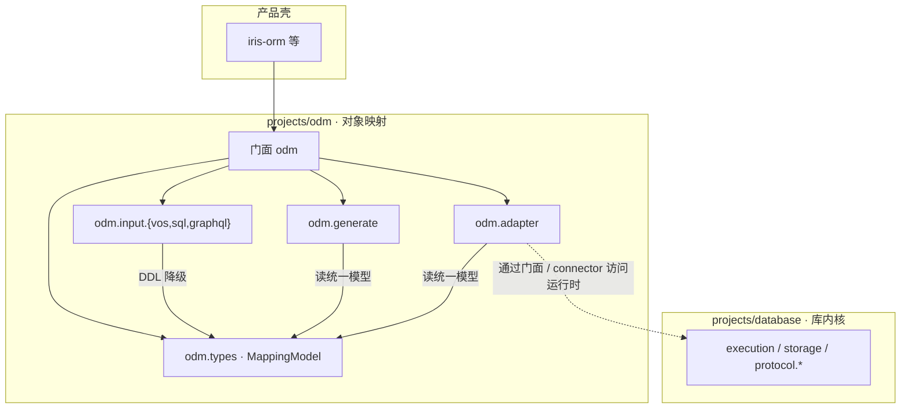
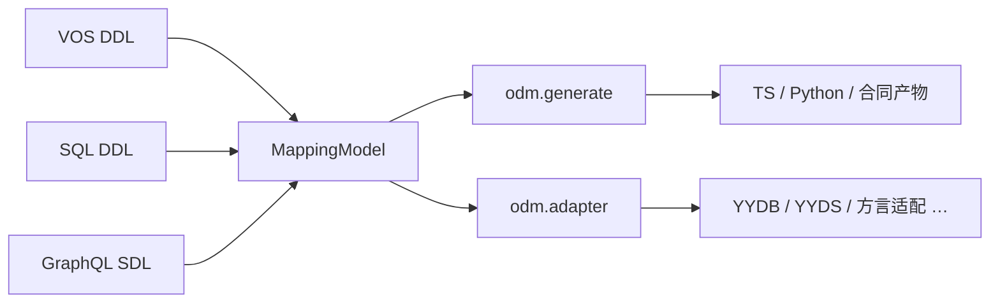

# ODM：对象—数据库映射

本目录是 **对象—数据库映射**（**O**bject-**D**atabase **M**apping）能力域，与 `projects/database`（存储 / 执行 / 线协议）正交：那边管「库怎么跑」，这边管「对象怎么落到库」。

公开门面 crate 是 [`odm`](./odm/)。产品壳（如 `iris-orm`）只依赖门面，不直接钉 `odm.*` 内部角色。

---

## 命名：拨乱反正

**ODM** 在本仓展开为 **Object-Database Mapping**（对象—**数据库**映射）：凡「用对象读写存储」的一层，都归这里。

把总称收成 ORM 是错位的——**R** 只覆盖 Relational。关系、文档、图、键值等各自又长出 ORM / Object-Document Mapping / OGM / ONDM 等叫法，内核却是同一件事。本仓用 **ODM** 做总称，是把这层能力从「关系库专有名词」拨回「对象 ↔ 数据库」本身，而不是跟 Mongo 社区抢缩写。

| 全称 | 中文 | 本仓角色 |
|------|------|----------|
| **Object-Database Mapping** | 对象—数据库映射 | 能力域总称与目录名 `odm` |
| Object-Relational Mapping | 对象—关系映射 | 家族成员（ORM） |
| Object-Document Mapping | 对象—文档映射 | 家族成员（文档向） |
| Object-Graph Mapping | 对象—图映射 | 家族成员（OGM） |
| Object-NoSQL Database Mappers | NoSQL 映射统称 | 家族成员（ONDM） |

文档侧历史称呼也叫 ODM；在本仓默认读总称即可。只有落到具体 Mongo / 文档库适配时，上下文本身就会把它收窄到文档向，不必每次加免责声明。

选用总称而非继续叫 ORM，还因为：

- 几乎每类数据库都有功能对等的对象映射，需要一个不绑关系模型的名字。
- `database.generate` 本就不属于库内核，挂在映射域更合理。

---

## 对象映射家族（本域覆盖面）

共同内核不变：**在面向对象代码与存储数据模型之间建一层抽象，让你用操作对象的方式读写数据**。变的是映射目标与惯用名：

| 缩写 | 全称 | 典型目标 | 本仓对应 |
|------|------|----------|----------|
| **ORM** | Object-**Relational** Mapping | 表 / 行 / 列（MySQL、PostgreSQL、SQLite…） | `EntityKindHint::Relational`；`odm.adapter` 关系适配 |
| **文档向** | Object-**Document** Mapping | 文档集合（MongoDB…） | `EntityKindHint::Document`；文档向输入与适配 |
| **OGM** | Object-**Graph** Mapping | 节点 / 边（Neo4j…） | `EntityKindHint::GraphNode`；图向扩展位 |
| **ONDM** | Object-**NoSQL** Database Mappers | 键值、列族等 NoSQL 统称 | `EntityKindHint::KeyValue` 等；如 Redis 适配 |

其他形态（列族、时序、统一 NoSQL API）同样落在本域：映射目标从「表」换成「文档 / 节点 / 键值」，**不**另开平行顶层目录。

```text
                    ┌─────────────────────────────────────┐
                    │  ODM = Object-Database Mapping       │
                    │         对象—数据库映射总称           │
                    └─────────────────────────────────────┘
                     │         │          │          │
                     ▼         ▼          ▼          ▼
                   ORM      文档向       OGM       ONDM
                关系表行    文档集合    图节点/边   键值/列族/…
```

---

## 和 `database.*`、产品壳的关系



- **`database.*`**：页、事务、执行、线协议；不管「对象字段怎么对应表/文档」。
- **`odm.*`**：DDL 作者面 → 统一 [`MappingModel`](./odm.types/src/model.rs) → 代码生成与外存适配。
- **产品壳**：品牌与绑定；映射实现以本目录为准，壳不复制一份引擎。

---

## 数据流：三种 DDL → 统一模型

并非所有库都从 SQL 出发。作者面先收敛到 **`MappingModel`**（实体、字段、关系、`kind_hint`），再交给生成与适配：

| Crate | 作者面 | 当前职责 |
|-------|--------|----------|
| [`odm.input.vos`](./odm.input.vos/) | VOS schema | 主作者面之一；`table` / `class` 等降到实体 |
| [`odm.input.sql`](./odm.input.sql/) | SQL DDL | 骨架级 `CREATE TABLE` → 关系向实体 |
| [`odm.input.graphql`](./odm.input.graphql/) | GraphQL SDL | `type` / `input` → 文档向实体骨架 |

输入面 **只做解析与投影**，不打开数据库、不跑迁移、不执行查询。



---

## 目录与 crate

| 路径 | Crate | 职责 |
|------|-------|------|
| `odm/` | `odm` | 能力域**唯一公开门面**；按 feature 再导出 |
| `odm.types/` | `odm-types` | 合同、`MappingModel`、会话、计划、投影状态 |
| `odm.input.vos/` | `odm-input-vos` | VOS → 统一模型 |
| `odm.input.sql/` | `odm-input-sql` | SQL DDL → 统一模型 |
| `odm.input.graphql/` | `odm-input-graphql` | GraphQL SDL → 统一模型 |
| `odm.generate/` | `odm-generate` | 模型与多语言代码生成（原 `database.generate` 归属） |
| `odm.adapter/` | `odm-adapter` | 外存 / 本地源适配与 connector |

门面 feature（见 [`odm/Cargo.toml`](./odm/Cargo.toml)）：`types`、`adapter`、`generate`、`input-vos`、`input-sql`、`input-graphql`。

---

## 写作与评审口径

1. 本仓写「ODM」即 **Object-Database Mapping**；入口文档补一次全称即可，日常不必加「非 Mongo」之类免责声明。
2. 落到 Mongo / 文档库实现时，用 `EntityKindHint::Document` 或「文档向」即可，靠上下文区分，不必另造「狭义 ODM」话术。
3. **标识符**保持 `odm` / `odm_*` / `MappingModel` 等英文（与 crate、serde 合同一致）；**说明文字用中文**。
4. 新增存储形态优先扩展 `EntityKindHint` 与 adapter，而不是再发明第四个顶层「xxM」目录。
5. 不要把线协议、页布局、执行器逻辑塞进本域；那是 `database.*` 的事。

---

## 相关入口

- 门面源码：[`odm/src/lib.rs`](./odm/src/lib.rs)
- 统一模型：[`odm.types/src/model.rs`](./odm.types/src/model.rs)
- 仓级产品故事：[`../../readme.md`](../../readme.md)
- 实现约定：[`../../AGENTS.md`](../../AGENTS.md)
